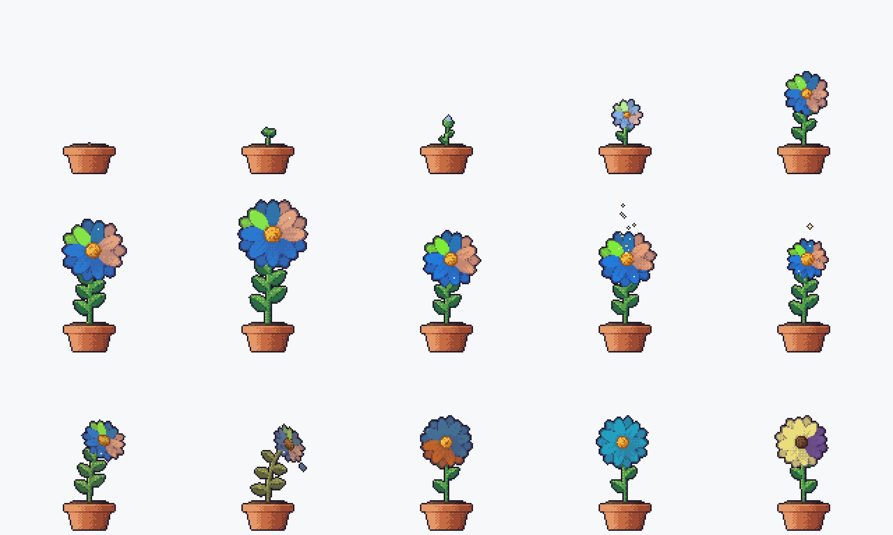

# git-bloom-activity

git-bloom-activity grows a pixel-art flower from one repository's commit
history. Its languages color the petals, its commits grow the plant, its weekly
streaks add leaves and shine, and the day that just ended decides how it moves.
A nightly workflow puts the flower in the repository's README as a looping GIF.



## What the flower shows

| Repository                  | Flower                                                                                                                |
| --------------------------- | --------------------------------------------------------------------------------------------------------------------- |
| Total commits               | Seed at 0, sprout from 1, bud from 10, open flower from 40; keeps growing with diminishing gains up to 10,000         |
| Languages                   | Each petal takes a language's GitHub color, in proportion to its share of the code; the top four languages get petals |
| Young repositories          | Petals show pale until 250 commits                                                                                    |
| Current weekly streak       | One extra leaf per two active weeks, up to four                                                                       |
| Longest weekly streak       | Petals grow more vivid up to a year; past half a year they glint                                                      |
| Yesterday's activity (mood) | See below                                                                                                             |

A week counts toward a streak when it has at least one commit, Monday through
Sunday. Merge commits and commits by GitHub Apps, such as this workflow's own
commits and Dependabot, are left out. Dates are author dates in UTC.

| Mood      | When                                                                                                                              |
| --------- | --------------------------------------------------------------------------------------------------------------------------------- |
| Wilting   | 60 or more days without commits                                                                                                   |
| Resting   | 14 or more days without commits                                                                                                   |
| Unfolding | The first day with commits in its week                                                                                            |
| Bursting  | Within a week of passing 40, 100, 500, 1k, 2.5k, 5k, or 10k commits, or a Sunday ending one of the busiest weeks of the last year |
| Swaying   | Any other day                                                                                                                     |

## Add it to a repository

1. Copy [examples/bloom-workflow.yml](examples/bloom-workflow.yml) into the
   repository as `.github/workflows/bloom.yml`.
2. Embed the flower in the repository's `README.md`:

   ```html
   
   ```

3. Run the workflow once from the Actions tab, so the first flower appears
   without waiting for midnight.

The workflow runs just after midnight UTC and whenever its file changes. It
needs `fetch-depth: 0` on checkout, since the flower reads the whole history.
Its built-in token is enough to read the languages, private repositories
included, and to push the updated GIF. It commits only when the GIF changed.

| Input        | Default            | Meaning                                                       |
| ------------ | ------------------ | ------------------------------------------------------------- |
| `output-dir` | `bloom`            | Folder that receives `bloom.gif`, `bloom.png`, `preview.html` |
| `repository` | The current one    | Repository whose languages to read, as `OWNER/NAME`           |
| `token`      | The built-in token | Token for reading the repository's languages                  |

Things to know:

- **Protected branches.** The commit step pushes to the branch it checked out.
  If that branch requires pull requests, the push fails; point the workflow at
  an unprotected branch, or allow the Actions bot to bypass the rule.
- **Build time.** The Action compiles itself on each run, which takes under a
  minute on `ubuntu-latest`. Publishing prebuilt binaries on release tags would
  remove that step.
- **Scheduled runs pause.** GitHub pauses scheduled workflows after 60 days
  without repository activity. Re-enable it from the Actions tab.

## Developing

```sh
cargo test
cargo run -- sheet --output docs/stages.png
cargo run -- render --repo-dir ../some-repo --repository OWNER/NAME --output-dir bloom
```

`render` needs an authenticated [GitHub CLI](https://cli.github.com) for the
language query. Open `bloom/preview.html` to see the result on GitHub's light
and dark page colors.

## Credits

The pipeline, the weekly streak rules, and the GIF and PNG encoders are adapted
from [git-koi](https://github.com/yalongwastaken/git-koi) by Anthony Yalong,
under the MIT License.

## License

MIT. See [LICENSE](LICENSE).
